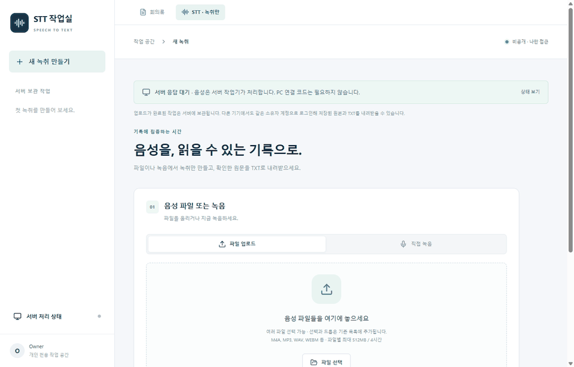
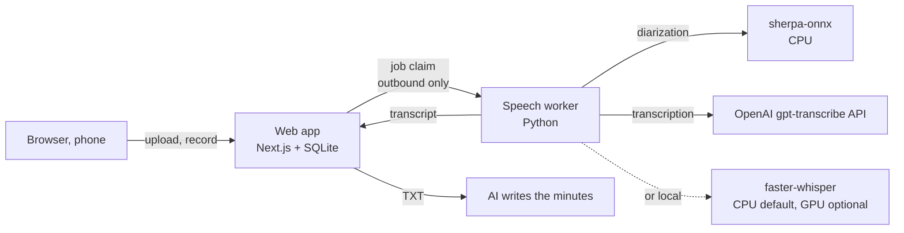

# korean-meeting-stt

A personal web app for Korean meeting recordings. Upload or record audio, get a transcript split by speaker, fix it in the browser, and download it as TXT. The author then hands the TXT to an AI coding tool to write the minutes. The main docs are in Korean ([README.md](README.md)).

> **Not a product.** One person built this with AI ("vibe coding") for their own work. It comes with no support or compatibility promise. It is public so others can read the code and the design.

The demo is a 2-minute synthetic meeting (one Korean TTS voice at three pitches, fictional names) transcribed on a laptop CPU with Whisper `base`; diarization split it into two speakers.

**Run it on your own computer** (Linux or WSL2, no API key): [docs/QUICKSTART.md](docs/QUICKSTART.md) (in Korean; the commands are plain).

## How it works

## API or local?

The author has no GPU. In their case a ChatGPT Pro subscription came with API credits, so they transcribe with OpenAI `gpt-transcribe`. Normally the API is pay-per-use: put the current price into the config yourself, and the app enforces a cost ceiling with it.

Same 25-minute synthetic meeting (Korean TTS), measured on 2026-11-26:

| Method | Transcription time | Character error rate |
| --- | --- | --- |
| OpenAI `gpt-transcribe` API | ~9 min | 4.2% |
| Laptop CPU, Whisper `large-v3-turbo` | ~10 min | 5.1% |
| Laptop CPU, Whisper `small` | ~6 min | 5.2% |
| Laptop CPU, Whisper `base` | ~3 min | 8.4% |

Local runs used faster-whisper on an i7-1165G7 laptop (4 cores, `int8`). Without a GPU or the credits, the author would run meetings that are not urgent on the local CPU. In server mode, local transcription never sends audio to OpenAI (server mode never falls back to the API), but either way the browser uploads the audio to the web server and the worker fetches it there. Synthetic audio only: real meetings will differ. Method: [docs/SPEECH.md](docs/SPEECH.md).

## With a GPU

Set `"whisper_device": "cuda", "whisper_compute_type": "float16"` in the worker config (default `cpu`, `int8`). It needs CUDA 12 cuBLAS and cuDNN 9. If they are missing, the job stops with "GPU setup needed" instead of silently falling back to CPU.

**Experimental: the author has never run a real GPU transcription.** Only the missing-library path was checked, on a 2 GB laptop GPU. Reports and PRs from GPU owners are welcome.

## Limits

- One owner only. Behind Cloudflare Access when exposed (the author's setup), or `MEETING_AUTH_MODE=local` on a computer one person uses: only direct requests to `http://127.0.0.1:<port>` from a browser that opened a one-time login link printed in the terminal.
- **Do not deploy `npm run build` / `npm start` yourself.** That build targets the OpenAI Sites host it started from and trusts the host's login headers, so anywhere else anyone can sign in. Use `npm run build:oci`.
- The local quickstart was reproduced from a fresh clone on WSL2 Ubuntu 24.04. The server setup ([docs/SELF-HOSTING.md](docs/SELF-HOSTING.md)) follows the author's server and was not reproduced elsewhere.
- Built for Korean meetings: local transcription is fixed to Korean and API transcription requests Korean (`ko`) by default; server mode has no setting to change it.
- The code has an optional path that infers meeting info through a ChatGPT subscription (Codex CLI). It is the author's personal setup, its terms were not checked, and it is off unless configured.
- `ops/` paths in code comments point to the author's private notes, which are not in this repository.
- The app does not write minutes ([docs/AI-MINUTES.md](docs/AI-MINUTES.md)).
- Accuracy on real meetings was not measured.

## License

[MIT](LICENSE). Bundled third-party files and downloaded models: [THIRD_PARTY_NOTICES.md](THIRD_PARTY_NOTICES.md).
