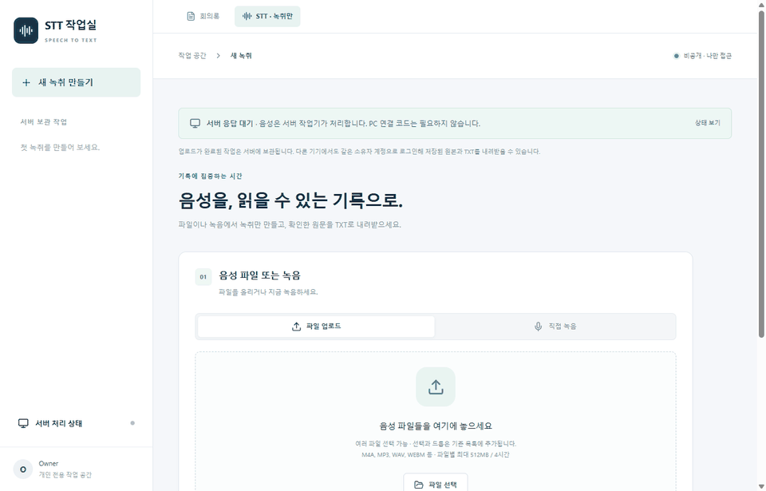
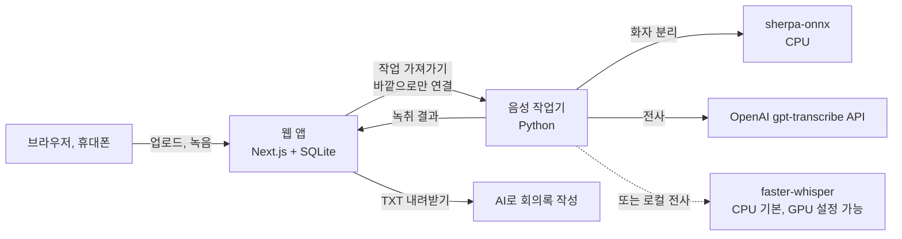

# korean-meeting-stt

한국어 회의 음성을 올리면 화자를 나누고 글로 받아 적어 주는 개인용 웹 앱입니다. 받아 적은 원문을 고친 뒤 TXT로 내려받아 AI로 회의록을 씁니다.

[English summary](README.en.md)

> **제품이 아닙니다.** 작성자 한 명의 업무에 맞춰 AI와 바이브 코딩으로 만든 도구입니다. 지원이나 호환성은 약속하지 않습니다. 코드와 설계를 보여 드리려고 공개합니다.



화면은 TTS로 만든 2분짜리 가짜 회의를 내 컴퓨터 CPU(Whisper `base`)로 처리한 것입니다. 한국어 TTS 목소리가 하나뿐이라 높낮이만 바꾼 세 목소리로 만들었고, 화자 분리는 그중 둘로 나눴습니다. 이름은 모두 가상입니다.

**내 컴퓨터에서 띄워 보기**: Linux나 WSL2에서 API 키 없이 됩니다. [docs/QUICKSTART.md](docs/QUICKSTART.md)

## 무엇을 하나요

1. 웹에서 음성 파일을 올리거나 브라우저로 녹음합니다(휴대폰 포함).
2. 서버의 음성 작업기가 화자를 나누고(sherpa-onnx) 글로 받아 적습니다(OpenAI `gpt-transcribe` API 또는 내 컴퓨터의 Whisper).
3. 화면에서 원음을 들으며 원문을 고치고, 목소리 라벨(S1, S2...)마다 이름을 정합니다. 같은 이름을 고른 라벨은 합쳐집니다.
4. 고친 원문을 TXT로 내려받습니다. 작성자는 이 TXT를 Claude Code에 넘겨 정해 둔 양식대로 회의록을 쓰고 Notion에 올립니다([AI로 회의록 쓰기](docs/AI-MINUTES.md)).



자세한 구조는 [docs/ARCHITECTURE.md](docs/ARCHITECTURE.md)에 있습니다.

## 왜 API로 전사하나요

저는 GPU가 없고, 제 경우 ChatGPT Pro 구독에 딸려 온 API 크레딧이 있어서 OpenAI `gpt-transcribe`로 전사합니다. 일반적으로 API는 쓴 만큼 요금이 나옵니다. 단가는 OpenAI 가격표를 보고 설정에 직접 넣으세요. 앱은 그 단가로 비용 상한을 지킵니다.

같은 25분 합성 회의로 재 봤습니다.

| 방식 | 전사 시간 | 글자 오류율 |
| --- | --- | --- |
| OpenAI `gpt-transcribe` API | 약 9분 | 4.2% |
| 노트북 CPU, Whisper `large-v3-turbo` | 약 10분 | 5.1% |
| 노트북 CPU, Whisper `small` | 약 6분 | 5.2% |
| 노트북 CPU, Whisper `base` | 약 3분 | 8.4% |

로컬은 Hugging Face의 OpenAI Whisper CTranslate2 변환본(faster-whisper)을 i7-1165G7 노트북(4코어, `int8`)에서 돌린 값입니다. GPU가 있거나 크레딧이 없었다면, 시간 여유가 있는 회의는 로컬 CPU로 돌렸을 것 같습니다. 서버 모드의 로컬 전사는 원음을 OpenAI에 보내지 않습니다(서버 모드는 API로 자동 전환하지 않습니다). 다만 원음은 어느 쪽이든 브라우저에서 웹 서버로 올라가 저장되고, 작업기가 그 서버에서 받아 처리합니다.

숫자는 TTS로 만든 합성 회의 한 개로 잰 것이라 실제 회의 정확도와는 다를 수 있습니다. 측정 방법은 [docs/SPEECH.md](docs/SPEECH.md)에 있습니다.

## GPU가 있다면

작업기 설정에 아래 두 값을 넣으면 NVIDIA GPU로 로컬 전사합니다. 기본값은 `cpu`, `int8`입니다.

```json
{ "whisper_device": "cuda", "whisper_compute_type": "float16" }
```

- CUDA 12의 cuBLAS와 cuDNN 9가 필요합니다(예: `pip install nvidia-cublas-cu12 nvidia-cudnn-cu12==9.*`).
- 라이브러리가 없으면 작업이 "GPU 설정 필요"로 멈추고 CPU로 몰래 바꾸지 않습니다.
- **실험 기능이고 작성자는 실제 GPU 전사를 돌려 보지 못했습니다.** 라이브러리가 없을 때 멈추는 동작까지만 2GB 노트북 GPU로 확인했습니다. GPU로 돌려 보신 분의 이슈와 PR을 환영합니다.

모델 표와 조건은 [docs/SPEECH.md](docs/SPEECH.md)에 있습니다.

## AI와 만들며 내린 결정

- **비용 상한.** 전사, 회의록 생성, 재시도의 API 비용을 장부 하나로 묶고, 상한을 넘기 전에 요청을 막습니다(`local_worker/budget.py`).
- **결과가 불분명하면 전역 차단.** 크레딧 소진이나 응답이 끊겨 과금 여부를 알 수 없을 때는 그 작업만이 아니라 서버 전체의 전사 API 호출을 멈추고 사람이 풀게 합니다(`local_worker/api_circuit.py`). 회의 정보 추정(글 API)에서 크레딧 소진이 나면 같은 전역 차단이 걸리지만, 시간 초과 같은 그 밖의 불분명한 결과는 추정 전용 차단만 걸고 전사는 계속 돕니다.
- **화자 분석과 전사 겹치기.** 화자 분석이 끝난 앞 구간부터 전사를 보내서 25분 합성 회의의 처리 시간이 940초에서 617초로 줄었습니다(API 전사 기준, `local_worker/pipeline_speech.py`).
- **화자 수를 추측하지 않음.** 5분 구간별로 나눈 뒤 같은 임베딩 모델로 전체를 다시 맞춥니다. 구간의 임시 번호를 사람으로 취급하지 않습니다(`local_worker/bounded_diarization.py`).
- **작업기는 바깥으로만 연결.** 작업기가 웹에서 작업을 가져가는 방식이라 작업기 쪽에 열린 포트가 없습니다.

## 지금 상태와 한계

| 항목 | 상태 |
| --- | --- |
| 로그인 | 소유자 한 명만 씁니다. 바깥에 열 때는 Cloudflare Access(작성자 운영 방식), 혼자 쓰는 내 컴퓨터에서는 `127.0.0.1`에만 묶이고 터미널이 준 일회용 로그인 주소로 들어가는 로컬 로그인 모드(`MEETING_AUTH_MODE=local`)를 씁니다. |
| 기본 빌드 주의 | `npm run build`와 `npm start`는 처음 시작한 OpenAI Sites 호스팅용입니다. 이 런타임은 호스트가 넣는 로그인 헤더를 그대로 믿기 때문에 **다른 곳에 띄우면 누구나 로그인할 수 있습니다.** 직접 띄울 때는 `npm run build:oci`만 쓰세요. |
| 설치 안내 | 로컬 실행([docs/QUICKSTART.md](docs/QUICKSTART.md))은 WSL2 Ubuntu 24.04에서 새로 받은 저장소로 처음부터 재현했습니다. 서버에 띄우는 방식([docs/SELF-HOSTING.md](docs/SELF-HOSTING.md))은 작성자 서버 기준이고 다른 서버에서 재현하지는 않았습니다. |
| 언어 | 한국어 회의용입니다. 로컬 전사는 한국어 고정이고, API 전사도 기본 한국어(`ko`)로 요청합니다. 서버 모드에는 언어를 바꾸는 설정이 없습니다. |
| 서버 모드 CPU 모델 | 작성자 서버의 메모리 제한(3GB)에 맞춰 Whisper `base`, `small`만 받습니다. 큰 모델은 `cuda`일 때만 받습니다. |
| 회의록 생성 | 앱이 하지 않습니다. TXT를 AI에 넘깁니다. |
| Windows PC 모드 | 예전 방식입니다. 코드는 남아 있지만 지원하지 않습니다. |
| 구독으로 회의 정보 추정 | 코드에 ChatGPT 구독(Codex CLI)으로 회의 정보를 추정하는 경로가 있습니다. 작성자 개인 용도이고 약관을 확인하지 않아 안내하지 않습니다. 설정을 켜지 않으면 동작하지 않습니다. |
| 코드 주석의 `ops/` | 공개하지 않은 작성자 운영 기록을 가리킵니다. 이 저장소에는 없습니다. |
| 정확도 | 실제 회의 정확도는 재지 않았습니다. 위 숫자는 합성 회의 기준입니다. |

## 폴더

- `app/`, `components/`, `lib/`: 웹 화면과 API. 4MB 조각 업로드, 편집, 진행 표시, 휴대폰 알림.
- `db/`, `drizzle/`: 작업, 버전, 업로드 기록의 스키마.
- `local_worker/`: 음성 작업기. 서버 모드 안내는 [local_worker/SERVER.md](local_worker/SERVER.md).
- `templates/`: 회의록 양식과 AI 작성 규칙(일반판).
- `tests/`: 합성 자료로만 만든 시험. 실제 음성이나 녹취는 없습니다.

## 시험

```bash
npm ci
node --experimental-strip-types --test tests/*.test.mjs
python -m unittest discover -s tests/local_worker
```

Python 시험에는 `requirements-worker.txt`의 패키지가 필요합니다.

## 라이선스

[MIT](LICENSE). 함께 들어 있는 다른 저작물(shadcn 스타일, 스타터에서 온 Vite 플러그인)과 내려받아 쓰는 모델의 조건은 [THIRD_PARTY_NOTICES.md](THIRD_PARTY_NOTICES.md)에 있습니다. 모델 파일은 저장소에 넣지 않습니다.
