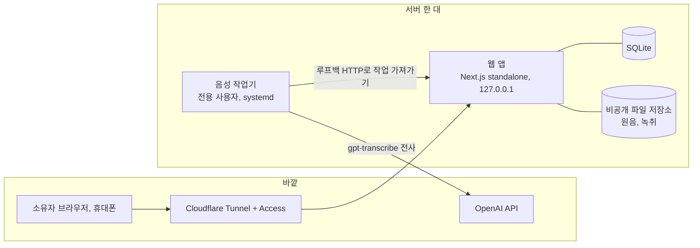
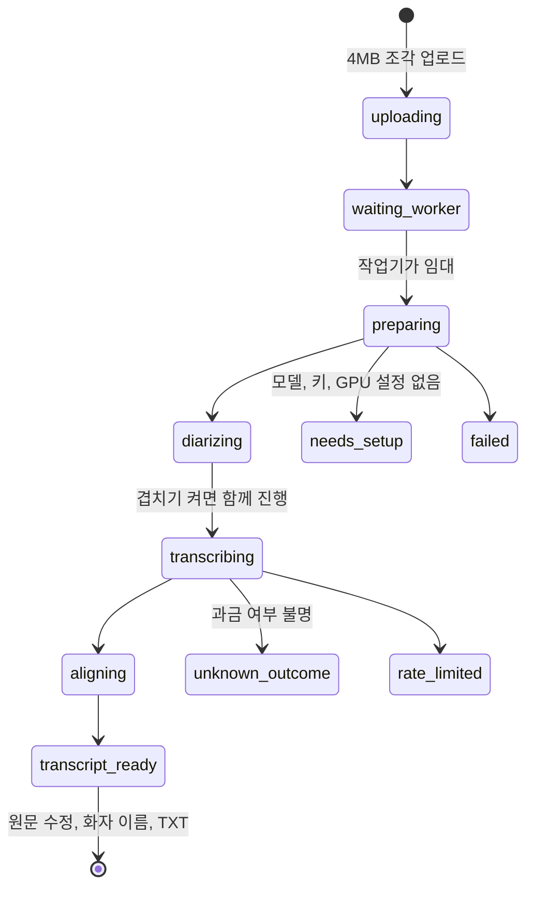
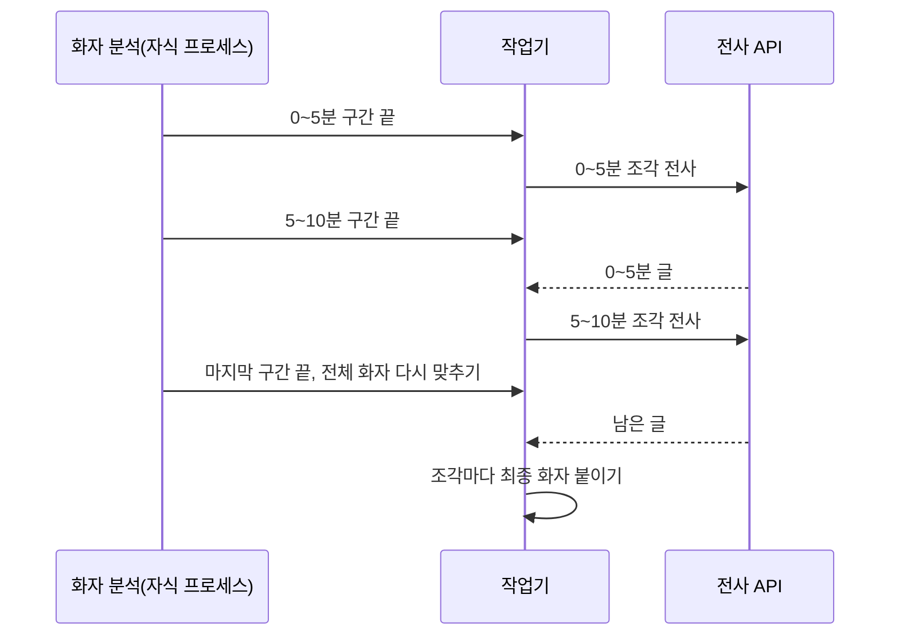

# 구조

작성자가 실제로 운영하는 모습 기준입니다. GPU 없는 ARM 리눅스 서버 한 대에 웹 앱과 음성 작업기를 함께 두고, Cloudflare Tunnel과 Access로 바깥에 엽니다.

## 구성

- **웹 앱**은 루프백에만 묶여 있고, Cloudflare Access가 넘긴 JWT로 소유자 한 명인지 확인합니다(`lib/runtime-access.ts`).
- **음성 작업기**는 웹에 작업을 달라고 묻는 쪽입니다. 작업기에 들어오는 연결은 없습니다. 평문 HTTP는 루프백 주소일 때만 허용하고, 원격 주소는 HTTPS만 씁니다.
- 작업기는 전용 리눅스 사용자로 돌고 root 실행을 거부합니다. 설정은 systemd `LoadCredential`로만 받습니다([local_worker/SERVER.md](../local_worker/SERVER.md)).

## 작업 상태

- 작업기는 작업을 **임대**합니다. 임대가 끝났거나 세대 번호가 바뀐 작업의 결과는 웹이 받지 않습니다(`lib/server.ts`).
- `unknown_outcome`이 나오면 서버 전체의 전사 API 호출이 멈춥니다. 같은 요청을 두 번 과금하지 않으려는 장치입니다(`local_worker/api_circuit.py`). 회의 정보 추정의 크레딧 소진도 같은 차단을 걸지만, 추정의 다른 불분명한 결과는 추정 전용 차단만 겁니다.
- `needs_setup`은 조용히 다른 방식으로 바꾸지 않고 사람에게 알리는 상태입니다. 예를 들어 GPU 라이브러리가 없으면 CPU로 바꾸지 않고 여기서 멈춥니다.

## 화자 분석과 전사 겹치기

- 화자 분석은 5분 구간(앞뒤 5초 문맥)으로 나누어 돌고, 끝나면 같은 임베딩 모델로 전체 화자를 다시 맞춥니다.
- 뒤 구간이 바꿀 수 없는 조각만 먼저 확정해 전사로 보냅니다. 유료 요청은 한 번에 하나만 보냅니다.
- 두 화자에 걸친 조각은 화자를 `unknown`으로 둡니다. 억지로 한 사람에게 붙이지 않습니다.
- 25분 합성 회의에서 940초 걸리던 처리가 617초로 줄었습니다(API 전사 기준).

## 데이터가 어디에 있나

| 데이터 | 위치 |
| --- | --- |
| 원음, 녹취, 수정 이력 | 서버의 비공개 데이터 폴더(SQLite와 파일). 전용 서비스 사용자만 읽습니다 |
| 브라우저에서 나가는 것 | 원음 전체가 웹 서버로 올라갑니다(로컬 전사여도 같음) |
| API로 나가는 것 | API 전사를 켰을 때 원음 조각. 회의 정보 추정을 켰을 때 녹취 글(OpenAI API, 또는 구독 Codex CLI를 켠 경우 그쪽) |
| 로컬 전사일 때 | 원음이 서버 밖으로 나가지 않습니다 |
| 화자 이름 | 사람이 정한 이름만 저장합니다. 목소리로 사람을 찾아 이름을 붙이지 않습니다(서버 모드) |
| 로그 | 작업 번호와 상태 코드만 남기고 녹취 내용은 남기지 않습니다 |

## 회의록

앱은 회의록을 쓰지 않습니다. 고친 녹취를 TXT로 내려받아 AI에 넘기는 방식입니다([AI-MINUTES.md](AI-MINUTES.md)). 웹 화면에 있는 회의록 탭과 Notion 내보내기 코드는 예전 Windows PC 모드에서 쓰던 것입니다.
